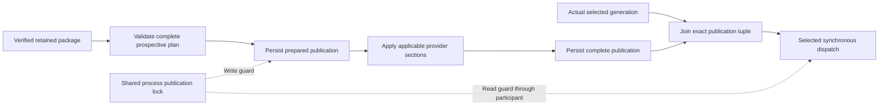

# Application package generation contract

Status: **Frozen for mainframe-env coverage.foundation**
Owner: **application-package maintainers**
Scope: **application package generation and installation contract**
Applies from: **mainframe-env current subsystem contracts**

Current writers emit `mainframe-env.application-package@3`, using the framed
identity defined in [ADR 0051](../decisions/0051-package-identity-framing.md).
The typed envelope is additive to the accepted profile.carddemo reader. It binds
the version 1 content-addressed manifest, a positive monotonic
generation, the typed subsystem section contract, and a signature verified by
an injected trust authority. Signature bytes and key IDs are carried by the
package; trust keys and secrets are not. The Rust DTO remains
`ApplicationPackageV2`; its section tag selects the finite @2 or @3 identity
domain. The schema describes the actual `base`, `generation`, `sections`, and
`signature` fields, including omitted or explicit-null optional IMS sections.

Fresh admission requires @3. Trusted retained @2 packages keep their original
identities and signatures; recovery verifies them under current trust. A legacy
retry must equal the complete retained package. Neither recovery nor retry
relabels a signature. Standalone @1 remains available. Back up retained state
before upgrading: an older binary cannot read current @3 generations.

Identity writers enforce default `PackageLimits` before materializing hash
inputs. Embedders with a larger approved budget use
`package_generation_identity_with_limits` and configure the installer with the
same limits. Native schema validation checks structure; it does not authenticate
signatures, establish cross-reference closure, or measure process heap usage.

The typed sections are host ABI libraries, SQL tables and seed rows, IMS
definitions and seed rows, optional versioned IMS DBD/PSB metadata, MQ
resources, batch controllers, and security resources. ABI members reference
package blobs that must also be fully
validated manifest entries; no subsystem reference can reach bytes outside the
signed content closure. SQL rows reference declared
tables and columns. IMS rows reference declared definitions and segments. Batch
controllers reference program entries. MQ targets and controllers reference
resources in the same generation. Every reference and bound is validated
before staging. Allocation-safe preflight text checks run before case
normalization, hashing, parsing, cloning, or owned-key construction. Every
top-level section count is checked in that first allocation-free pass. Bounds
cover aggregate manifest/blob
bytes, total nested entries, per-library ABI members, SQL columns/keys/rows,
IMS segments/rows, controller property maps, conservative structural memory,
and per-application and global retained byte and item totals; the installer
rejects hostile input before hashing or cloning it.

The optional `ims_tm` section binds each transaction's PSB, program selector,
artifact digest, execution context, timeout, conversation size, and alternate
PCB routes to the signed generation. The PSB and alternate PCBs must match the
validated IMS metadata; the selector and artifact must match one signed program
entry. An absent section preserves older package wire forms and identity. TM
publication uses the existing application publication state. The TM provider
retains immutable generation definitions through `ProviderStateStore`; message,
session, and conversation rows keep their generation binding across package
rollback. The public server TM API admits new messages only from the complete
selected generation and resolves continued work through retained ready ones.
This bounded TM runtime selects one active TM application at a time; a second
active TM application conflicts at publication instead of replacing its
catalog. Packages without TM definitions do not displace another application.

Installation uses bounded, durable retained per-application generations.
Staging records a fully verified identity but does not change selection. The
retained package graph and selection are persisted under
`mainframe-env.application-installer@1`; open re-runs bounds, signature, digest,
size, and reference-closure validation before any retained handle is usable.
Commit marks that exact identity ready and selects it in one critical section.
A retry of the same identity is idempotent. Corrupt, conflicting, partial,
stale, or unverified generations cannot become selected. Rollback selects a
retained ready generation and does not reconstruct it from mutable source
paths.

`ProductServer` publishes controller, Db2, and IMS metadata sections through one serialized
`mainframe-env.application-publication@1` state machine. The prepared record is
bound to the expected package generation and identity. Each applicable section
is durably `pending`, `applying`, `applied`, or `failed`; restart retries
idempotent provider operations from explicit partial state. Selection becomes
complete only after all applicable sections are durable. This is recovery over
separate provider transactions, not a cross-provider exactly-once claim.

Selected batch controllers and IMS routes join the actual retained selection
with a complete publication row: namespace, key, positive row version, package,
generation and identity must match, and applicable signed sections must be
`applied`. An absent publication row cannot authorize a standalone controller.
Controller and SQL catalog plans are validated before the prepared record or
provider effects; completed replay still validates signed shape and closure.

The server and its batch service share one process-local publication lock
([ADR 0053](../decisions/0053-selected-controller-publication-fence.md)). Selected
dispatch retains a read guard through the synchronous participant call.
Publication, rollback, recovery and executable installation use a write guard;
contention refuses immediately. The service creates its borrowed writer under
that actual guard, so callers cannot construct or serialize an admission permit.
There is no lock upgrade or guard held across an await. Raw store writers remain
a trusted embedding responsibility; this lock provides no cross-process or
distributed exclusion.

IMS metadata publication uses the shared `mainframe-env.ims-metadata@1` DTO and
validator. The provider atomically retains the package-bound generation and
advances its selected-generation row through `ProviderStateStore`; rollback
selects the exact retained generation. A package without the optional field
keeps its frozen @2 identity when retained; current @3 frames optional-field
presence explicitly. It publishes an explicit no-metadata
selection, so a later generation cannot accidentally inherit stale IMS state.

`ProductServer` owns the v2 installer. Its production constructor receives a
verification-only keyed HMAC-SHA256 authority assembled from
`MAINFRAME_ENV_PACKAGE_HMAC_KEY_REFS`, a JSON map of key IDs to `SecretRef`
values. Verification resolves each reference within the secret-provider
boundary into a non-cloneable, non-debuggable, zeroizing transient wrapper.
Missing, revoked, or malformed material denies the package; plaintext keys and
signing operations are absent from the production verifier. Subsystem
publishers obtain an opaque selected-generation handle from the installer,
never a caller-provided digest.

Fresh production packages use the bounded canonical `cose-mac0-hmac256@1`
profile ([ADR 0055](../decisions/0055-standard-package-mac-envelope.md)):
tagged COSE_Mac0, protected HMAC-256 algorithm and matching UTF-8 key ID,
empty unprotected headers, the attached computed package identity, a 32-byte
MAC and fixed application-authentication external AAD. Key IDs are 1–64 bytes
and contain no control characters. Encoded signatures are capped at 256 bytes
and decoded envelopes at 192 bytes before parsing. Noncanonical, duplicate,
unknown or critical headers, trailing data and mismatched identities refuse
before secret resolution. These bounds limit parser work, not total process heap.

The existing `hmac-sha256@1` profile remains an explicit retained verification
branch, with a 43-byte encoded cap, exactly 32 decoded MAC bytes and retained
key IDs up to 128 bytes. Configured references retain that 128-byte limit; both
profiles require resolved secrets of 32–4096 bytes. Production fresh admission
accepts only the COSE profile. Retained raw @2 or @3 packages recover under
current trust without rewriting their signature. If either side of an
existing-generation retry uses the legacy policy, the complete package must
equal the retained package; retry cannot upgrade or downgrade its envelope.
Custom injected verifiers retain their explicit policy and are not evidence
that production trust accepted a package. Symmetric MAC authentication does
not provide nonrepudiation or authenticate an arbitrary storage snapshot.

The migration from `mainframe-env.application-package@1` to version 2 is
non-destructive. The old reader remains, and rollback remains possible by
selecting the prior ready generation or by continuing to read an accepted v1
package. Version 2 now persists retained installer and explicit publication
recovery state; migration remains additive and does not select partial provider
state.

## Finite owned local composition

The proposed local composition profile ([ADR 0064](../decisions/0064-local-application-composition.md)) prepares actual dataset seed and CICS definition owners and commits their exact provider rows with the ordinary installer selection in one shared-store atomic call. It binds full signed program, explicit resource, transaction target and raw seed bytes. Its full seed snapshot binding includes attributes. Exact successful retries preserve runtime edits; retained rollback and reopening join the original generation and full static rows. Unknown atomic returns fence live owners until authoritative reopen.

This finite profile refuses sections without a genuine held preparation. Complete signed raw Source files and their dependency closure now pass through the actual bounded compiler and must reproduce the entire offered publisher result; full SourceIds join the local selection, retry and receipt. The explicit finite first-party profile signs exact canonical Resource commitments at `source-commitment/{PROGRAM}` and requires the Program dependency: actual SourceId plus executable mode/target/full request options/logical Source mapping must match before compilation. SourceId authenticates all immutable bundle metadata, including format/encoding/provenance/COPY order; the existing signed Resource hash authenticates the remaining declaration. A same-payload metadata change requires a genuinely newly signed commitment. This establishes identity admission; package-only SourceBundle reconstruction still requires a separate encoding, and vendor/global equivalence is not inferred. Verified Profile and Migration content does not establish external policy installation or migration execution. Its implementation controls remain unrun, and it does not change the frozen global application, V3, seed, rollback, oracle, vendor or Foundation acceptance criteria.

### Finite owned RACF profile participant

ADR-0068 extends the ADR-0064 local composition with a genuine held SecurityDatabase
participant. The new first-party `mainframe-env.application-local-racf-profile@1`
payload is authenticated as an exact signed Profile entry and must agree with the
original class/profile/owner section. Complete UACC and unconditional grants are
explicit; existing principals, classes and templates are required. The provider's
real MERACF2 codec validates the full prepared snapshot and the same-store atomic
acknowledgement controls release of its writer.

The selected authority is a full participating-profile/class/template projection,
not a copy of mutable audit/session/token state. Exact retry preserves runtime
updates, while upgrade and rollback assign monotonic profile versions to the signed
content in the current snapshot. CURRENT foreign package ownership refuses before
retry, even after trusted administration empties or removes the profile. Unknown
publication quarantines the live provider until reopen. Raclisted classes, arbitrary
segments/conditions and vendor syntax are outside this finite local profile.

### Finite owned local Db2 participant

ADR-0069 joins the existing signed `data/db2/catalog` codec and all typed SQL
sections through an actual held Db2 catalog preparation and the genuine shared
store acknowledgement. Full static definitions/CURRENT ownership and actual
provider versions determine finite readiness; original runtime rows and retained
rollback snapshots remain real provider state. The lock precedes the RACF writer.
This Put-only fixed-name profile refuses legacy adoption, foreign ownership, stale
state and unknown outcomes. Its bounded history admission does not change legacy
provider limits. SQLCA/IBM interpretation, full V3 and Foundation acceptance remain
separate original obligations; no new complete flag or component PASS is substituted.

The finite local composition profile may include the full existing IMS metadata catalog using ADR-0071. Its genuine initial generic engine images and retained metadata-generation selection are committed with the same held provider transaction. Package-generation changes and rollback preserve the byte-equal catalog and all actual runtime records; changed catalog schemas, legacy IMS seed declarations and TM installation remain separate participants. No complete application-publication state or vendor semantics are inferred from this local Ready composition.

The proposed finite local MQ participant authenticates full signed queue Resource bytes and retains one unchanged original typed catalog across generation changes and rollback. It holds the genuine MQ durable owner before RACF, compares complete original rows, advances the original runtime manifest in the shared CAS and requires same-store acknowledgement. Native MQI, Process/Trigger graph mapping and controller dispatch remain separate local work. See [ADR-0072](../decisions/0072-local-fixed-mq-queue-composition.md).

The finite owned local composition may additionally select exact signed TSO ProgramCall controller definitions and their genuine compiled `batch-program` bindings. The batch provider holds its actual registry owner, validates the original full registry and retained-generation rules, joins the exact CAS row to the same-store commit, and fences unknown acknowledgement. Readiness compares full selected content and mappings; unrelated controllers and JES runtime remain owned by their original services. This installation profile preserves the separate genuine Complete-publication requirement for controller execution; it grants no execution or global CD009 completion authority. The explicit signed Resource contract and finite snapshot budgets are specified in ADR-0073.
