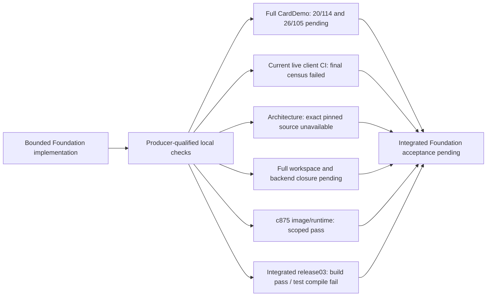

# Coverage and conformance — Coverage authority progress

Subsystem: **coverage**

Phase: **foundation**

Status: **ACTIVE — integrated acceptance pending; feasible local work continues**

## Current review candidate — verified implementation `e23ddff6`, Foundation ACTIVE

PR #393 remains open and Ready for review. Published implementation `e23ddff6`
integrates verified cursor dispatch recording `2f514911` and SDK PRE validation
overlap `e23ddff6` after group43 `4c25ecb4`. Both implementation commits were
pushed separately with exact remote readbacks. A fresh integrated xtask build,
normal docs generation/check, fmt, deny and changelog all pass on the recorded
`e23ddff6` plus owning-status source. The current editorial update is checked
through normal documentation generation before publication. Integrated native
acceptance remains pending. The default checkout remains on main; review
readiness and sandbox readiness do not complete Foundation.

Every receipt retains its actual producer and changed-source map. Private focused
passes are not integrated native acceptance. The original physical J19/J20 owner
actually passed at clean `4c25ecb4`; two PostgreSQL composition owners actually
passed at `24e5f898`. Earlier failures remain immutable. External evidence is under
`resume-recovery-20261015-01`.

| Acceptance requirement | Achieved | Unrun | Failed | Blocked | Evidence | Next step |
|---|---|---|---|---|---|---|
| Implementation and policies | Earlier 29 focused controls and 16 policy/generator rows retain their sources. Memory change passes 23 commands including 19 Rust controls and strict Store Clippy. Six integrated tool/docs/fmt/deny/changelog commands pass at `179c6254`; four normal docs/deny/changelog rows and genuine export pass for source published as `4c25ecb4`. New fresh integrated build/docs/fmt/deny/changelog all **6 PASS**, source map `ce79edce` before normal generation | Final documented-source export and remaining integrated native campaigns | Historical compiler/policy/monitor failures retained | None for verified scope | `memory-audit-range-verified01`; `integrated-groups40-41-validation01`; `SDK-buffer-integrated-policy-actual01`; `current-source-export-group43-01`; `integrated-cursor-SDK-policy-prepared01/receipts02` | Publish normal documentation, export actual documented source, then bind original native owners |
| SDK input validation and supervision | Published tar buffer repair passes **61+197 Python controls**, zero skips. Latest scoped PRE-overlap repair passes **68+197**, five mandatory policy rows and checked default-target cleanup. Single original12-pin validation-only context passes PRE5.341132024s/sole POST0.981559320s. All SHA/SRI/bounds, PRE/POST identity, deterministic refusal and worker-join predicates retained | Successful original ten-action native journey on changed source; actions after SDK04 first submit remain unvisited | SDK04 at `4c25ecb4` **FAIL0/1/0**, native14.47s: original inclusive **10s** command allowance exceeded. Launcher/child exit0, HTTP201 and checked cleanup do not satisfy that timer; no unchanged retry | No local input missing | `SDK-tar-buffer-verified01`; `SDK-pre-overlap-verified01/review.json`; `PG3-SDK-current04/sdk-runtime/evidence` | Run original changed-source native owner with original inputs and limits. Validation-only timing measures no native CLI action, 10s feasibility or controlled speedup |
| Memory namespace queries / DATE READ binding | Page scan preserves exact bytes/order/refusals and oversized legacy fallback. Audit/run ranges preserve physical tuple keys, corrupt/empty rows, quota order and rollback. Six DATE controls plus all three original failed transaction cases pass; exact COTRN02C request accepts V4, others V3 | Original integrated runtime effect and complete online/workspace conjunctions | Earlier CRE/whole failures remain failed; no causal speedup claimed | None for focused repair | `memory-audit-range-verified01`; `namespace-legacy-allocation-actual01`; `composed-date-fix-actual02` | Run eligible original changed-source workloads without changing deadlines |
| Cursor dispatch recording / compiled overlap | Reviewed repair records real StartBrowse/ReadNext/cursor-Close dispatches and refuses completed volatile replay before host redispatch. Eight new plus 13 original controls and all 11 selected command rows pass, including strict affected Clippy. Original 20 controls retain actual earlier source and reviewed reuse | Original native compiled-overlap owner after integration | Prior new-control attempt7P/1F fixture-observer failure retained. At clean ac82 original overlap **FAIL0/1/0**,167.67s: completed-effect witness absent. Retained16 jobs/102-record spools match, but848 EffectResult events have null journals; no overlap PASS | None for this grounded repair | `dataset-cursor-journal-verified01/attempt02`; `cursor-fixture-independent-review02`; `CardDemo-independent-default-owners-actual02/independent-compiled-overlap-forensics01` | Run unchanged original overlap owner only on relevant changed inputs; preserve original witness/oracles/caps and zero cursor-restoration claim |
| Independent financial provenance #245/#262 | Eight reader/two financial controls pass; producer reproduces original36 pins. Companion attributes six independent record-count/u32-framed hash leaves; legacy metadata/u64 digests remain self-recorded; v1 unchanged | Successful complete runtime owner and emitted companion | No runtime companion PASS while Base fails | No missing local producer/reader input | `current-final-policy-prepared01`; ADR-0078 | Complete original jobs/comparisons/restart/both drains/checked cleanup before runtime credit |
| Base batch / CREASTMT, original layout/CCSID/deadlines | Diagnostics identify STEP040/CBSTM03A; later spool shows step/job RC0000. Separate failed profile measured parent177.037s, drive4.817s, inclusive dispatch171.923s;472 nested calls5.487s already included | Original successful workflow and remaining comparisons/cleanup on relevant changed source | Original owner **exit101**,322.26s at unchanged **120s** job predicate; diagnostic profile also failed. Residual cost not attributed to one provider | None for runtime investigation | `base-cre-range-diagnostic-actual01`; `cre-cost-profile-prepared01/independent-observation/final-cost-review.json` | Run original owner after relevant integrated repair; preserve #186/#273 ownership and all original byte comparisons |
| Independent CardDemo owners at clean ac82 | **5 PASS**: initial SQLite12 jobs/full9 datasets, retained V3, full installed catalog, seed lifecycle, corpus negative campaign. Every group closed/resource-valid/source-unchanged; corpus copy cleanup checked | Complete current application conjunctions | Sixth compiled-overlap owner failed as above; no unchanged retry | None for retained-outcome investigation | `CardDemo-independent-default-owners-actual02/owners/results.json`, actual ac82 map `1b678d68` | Preserve scoped passes at actual source; run remaining eligible complete owners |
| J09 and physical J19/J20 | Original J09 Group33 two-process SQLite PASS retains all13 comparisons and reviewed unchanged owning inputs. Clean `4c25ecb4` original ignored physical owner **PASS1/0/0**,10.91s native:16 offers/16 completions, SQLite backup/restore, PostgreSQL restart, two cross-principal controls. All15 command rows pass with source/resource/group checks and exact SQL/directory cleanup | Full J19/J20 conjunction including online/batch concurrency, provider failure, unknown outcomes and cancellation | Earlier application failures remain failed | None for completed physical owner | `physical-J19-J20-current43-actual01/summary.json` and `HANDOFF.md`; earlier J09 receipts | Retain physical PASS at its producer; execute missing original application observations. One owner does not complete J20 or registered PostgreSQL profile |
| Complete CardDemo / IMS / online | Qualified selected owners and reviewed resource inventory retain scope | **20/20 journeys,114/114 observations;26/26 selected issues,105/105 acceptances**. Original all-feature base-online owner must retain exact50/300/500-byte READ postimages; IMS/other installed-data owners remain required | Earlier full closure failures remain; cold-CONNECT history is qualified below | Exact COPAUS0 private oracle mismatch; raw ABI sources selectively block dependent owners | Current CardDemo/IMS matrices; `J09-source-inventory-diff-scope-review01.json`; original receipts | Run independently available owners on eligible source; obtain exact private oracle without re-pinning. Preserve CD-027 exclusion |
| MQ cold CONNECT / local ownership | Later changed compiled custody/successor original named case printed `ok` once in native17, actual base `a76a35b9` plus frozen3,210-path source; its40 readiness pins equal committed `c519f395`. Exact original assertions/backend loop retained | Current original whole455 result and complete MQ application conjunction | Historical7893 failure remains retained. Native17 enclosing whole owner failed its original1,800s deadline despite the selected case completing; no whole/floor credit | Missing raw MQI9.4 bodies block new semantics/vendor equivalence, not existing local ownership analysis | `mq-cold-current-cause-review01/CAUSE-REPORT.md`; actual native17 close supplement/raw line5351 | Run already-planned changed-source whole owner, which selects this exact case; no new production repair or duplicate standalone retry justified |
| Three signed PostgreSQL composition owners | Two remaining original selectors **PASS1/0/0 each** at clean `24e5f898`, original guards/resources, fresh owned database/tablespace cleanup | First owner's complete gen2/rollback/final-reopen conjunction | Original first selector **FAIL**: gen2 Db2 actual ONE+TWO versus oracle TWO. Proper checked stop; stopped forensic cluster retained | Exact-oracle correction proposal awaits explicit user decision; unapplied | `PG3-independent-remaining-two-actual01`; `PG3-SDK-current03/pg3-runtime/evidence`; `PG3-current03-oracle-correction-proposal01` | Respect pending decision. If authorized, verify bounded correction and run original first owner on fresh owned inputs; never retry unchanged failure |
| Whole workspace / registered backend | Earlier workspace strict/MSRV and current scoped policies retain actual producers. Physical `postgres-carddemo-restart` selector now passes at `4c25ecb4`; separate PG3 passes retain source | Original **whole455/min260**; complete **12-gate registered PostgreSQL profile/recorder**; current affected workspace strict/MSRV and remaining backends | Earlier whole Conformance727P/3F/37ignored then controller loss before final summary; zero whole-floor credit | Sources constrain dependent semantics only | `whole02-Root-observed-interruption.json`; `tools/jenkins/postgres_parity.sh`; physical owner receipts; original bindings | Bind genuine final-source export and run original owned commands/profile summary; preserve existing PostgreSQL services. Scoped/PG3 counts are no substitute |
| Assurance six / performance | Original tools/inputs available. Performance versioned successor reviewed; oracle13 positive/55 negative controls pass; native measurements zero | Six original owners: model minimum5; four fuzz targets256 smoke/4096 periodic; four-package coverage900 functions/10000 covered/12000 total lines; workspace targets and warnings-denied rustdoc. Performance four release builds/three rounds/**66 cells** | Existing failures retained; no native performance PASS or improvement claim | Comparable batch performance depends on #410/#186 correctness; independent finite probes feasible | `tools/assurance-gates.json`; `final-clean-rebind-prepared02`; `perf412-producer-successor-02` | Rebind final source/export and actual machine/serial facts; execute original owners/schedule with unchanged oracles, record counts and caps |
| Public distribution | Private pinned BuildKit0.24.0 worker and official TLS/network probes ready. Mount-order-only successor preserves all 11 checks/caps;124 positive/98 negative controls pass | Current-source image build/import and **11 runtime checks** | Helper01 worker-detection failure retained; no current application build ran | Fresh storage peak unmeasured; no proven permanent storage blocker | `distribution-private-backend-actual03`; `distribution-mount-order-successor-v2-review01`; `distribution-current-group42-v2-prepared01` | Rebind final source/export, review actual headroom, run original actor with private backend; preserve managed daemon/images/state. No publish/deploy claim |
| Architecture / official sources / licensed differential | Pinned manifests and matching retained material preserved; structural passes retain source | Current affected source/schema/catalog/profile/evidence/architecture gates and nine licensed comparisons | **26 official HTTP requests403**, zero pinned matches; no unchanged retry | Missing exact HTML/TOCs/raw ABI and licensed runner/captures. r_dump.html44,235B SHA0234352759c3d24a0e56db00eaa8a0ad509e4e936889dc2af7ebf1cc6bdd14ee | Immutable official refusal receipts/source manifests | Supply matching references or working authorized source access and licensed runner/captures; continue all independent local gates |

Foundation remains **ACTIVE**. Preserve all **six coverage gates**, **1,506
identities**, exact-zero production H1/application string dispatch, source pins,
selectors, oracles, floors and caps. The original financial workload remains
authoritative; generic 4,097/5,000/65,536 paging controls create no financial floor.
Focused successes never aggregate into the original whole-workspace floor.
No unchanged failed gate is retried and no acceptance limit relaxed. Earlier
cleanup refusals remain refused after later physical absence; required raw,
source and artifact evidence remains outside disposable targets.

## Scope and acceptance boundary

Foundation owns pinned catalogs, six independent coverage gates, semantic
identities, package trust/install runtime, subsystem ABI libraries, program/route
registration and cross-subsystem validation. Scoped results retain their actual
producer and reviewed input/source equivalence. Sealing source, importing a
catalog, building a tool or passing selected comparisons does not establish an
unchanged clean-candidate integrated pass. Execution records remain external.

The corpus driver package is sealed at `72a04b25`; its two Python owners
and unique change fragment were committed after their twelve actual controls
passed. The earlier sealed parser package `eb21dba5` passes 189 focused Python
controls. Neither commit is a clean HEAD producer for the integrated Rust
changes: the release03 tool was built from the separately frozen development
source at base `c8758b21`, with 83 changed source identities. Its test builder
failed before any Rust test ran. The later CLI continuation at `eb21dba5` uses
that exact retained tool, with only the three reviewed Python parser paths
differing from its compiled source manifest. Actual failed owners remain
failed. Foundation is **ACTIVE** while source-complete local comparisons,
fixture corrections and current gates continue.

| Retained commit | Sealed bounded change |
|---|---|
| `549168b3` | Census metadata reads and owned mutation/supervision checks |
| `936ccd2d` | Descendant trace framing |
| `d27e0039` | Current-checkout public-client compatibility |
| `849851e3` | Client tree-name validation cost |
| `0f94646d` | Genuine nested clock/deadline/cancellation controls |
| `1e166c91` | Client canonical-name validation cost |
| `25f15d5a` | Exact Db2 PS/KSDS observation |
| `b87304f3` | Client archive lexical validation cost |
| `f7367410` | Selected CardDemo observation and teardown ownership |
| `c8758b21` | Bounded failure-only census diagnostics |
| `eb21dba5` | Linux stat tokenization cost with 189 passing focused controls |
| `72a04b25` | Owned corpus-campaign driver with twelve passing controls |

Public implementation excludes licensed/private-only work and the three unready
CICS rows **CICSMESSAGE**, **GETNEXT TIMER** and **ISSUE COPY**. Preserve their
identities, specifications, fixtures, tests and pending gates. Missing supplemental
IBM bodies remain **user-skipped/unavailable, zero credit**; do not refresh/re-pin
or repeat unchanged missing-source requests. Independently feasible public
validation remains required.

The original **IBM MQ 9.4 MQI semantic baseline is unavailable**, separately
from skipped supplements. It blocks new MQI semantic repair and earns zero
licensed/differential credit. Actual local contract/provider controls remain
useful within their declared scope; they do not establish executed first-party
MQ/IMS application workflows.

## Work packages

| Package | Accepted bounded scope | Remaining boundary |
|---|---|---|
| CV-201 | Nine pinned baseline manifests, normalized catalogs and locator membership | Preserve source identities and denominators; unavailable bodies give zero credit |
| CV-202 | Six independent gates, immutable coverage/snapshots, continuity, schema bindings and package-state projections | Structural schemas supplement typed identity/topology/derived-count validation; integrated gates remain required |
| CV-203 | Generated semantic identities/handler registry and repaired bindings | Registration is not runtime credit; selected routes require actual observations |
| CV-204 | Bounded packages, atomic generation selection/rollback, framed @3 identities, canonical COSE_Mac0 authentication and publication fencing | Fresh authentication uses `cose-mac0-hmac256@1`; retained @2/raw identities verify without rewriting. MAC gives neither nonrepudiation nor arbitrary snapshot authentication. Process-local fencing/file-SQLite recovery do not prove distributed exclusion/backend parity |
| CV-205 | Generic Db2 install/rollback, retained generations and seed-at-capacity controls | Current backend/application obligations; same-process reopen is not a process crash |
| CV-206 | Installed typed batch controllers and duplicate-root/root-width admission | Actual signed package/publication selection precedes effects; retain integration gates |
| CV-207 | Provider-owned CICS/Db2/MQ source libraries, bindings and bounded materialization | Preserve ABI bytes/licensing/source identities; local tests are not licensed equivalence |
| CV-208 | Official/custom route and common-program registration, scanner and typed policy | Preserve namespaces and ownership; registration does not establish execution coverage |
| CV-209 | Scoped lint/layout/tooling/conformance, runtime and compatibility prerequisites below | Workspace/MSRV, application, backend, live-client, distribution/performance and integrated exit remain pending |

The nine baselines retain **1,506 mandatory identities**. Every applicable
`recognized`, `validated`, `executed`, `conditioned`, `recovered` and `differential`
gate must pass before a row is complete. Numerators/denominators belong to their
catalog/applicability/verdict owners. The five VSAM normalization rows retain
zero-publication credit; the original z/OSMF heading denominator stays frozen,
with endpoint normalization under its separate source-bound projection.

## Producer-qualified bounded results

Each row records the scope of an actual earlier result. These rows cannot be
summed into a substitute full workspace floor, workload closure or clean final
candidate pass. Old failed receipts remain retained beside later scoped results.

| Owner | Actual producer-qualified result | Current acceptance boundary |
|---|---|---|
| Catalog/schema/registry policy | At command candidate `0f94646d`, the actual retained `d3ff8818` xtask passes coverage, schemas, inventory, spec, profiles, semantic identities, package/Db2/batch/ABI/program/route registries, public API, module/typed boundaries and dehardcoding | The tool keeps its actual binary producer. Reviewed tool/sandbox/lock/coverage owners are unchanged through `b87304f3`; changed conformance/input owners require their own validation. Generated catalogs supply zero semantic credit; production H1 application hardcodes and application string dispatch must remain exactly zero |
| Workspace strict and MSRV | Clean `0f94646d` passes all-target/all-feature Clippy with warnings denied, target compilation, warnings-denied rustdoc and pinned Rust 1.95.0 compilation | Current integrated source still needs affected checks. Successful earlier checks retain their producing scope |
| Workspace regression | Full `b7d9ff93` command failed 46 tests and earns zero 260-floor credit. The later `0f94646d` workspace subset passes 4,980 tests and explicitly excludes `mainframe-env-server` | The actual successful full workspace command with at least 260 passing tests remains required. Ignore/filter/skip/zero-test counts and selected result aggregation cannot fill it |
| MQ mechanical/provider ownership | Earlier mapped production lint repairs preserve rich-store state and all selected fencing/binding controls. The scoped development suite reports 492 passes (452 unit, 32 integration, eight compile-fail doctests); the original 24-warning failure remains retained | These earlier results do not supply current full MQ lifecycle/recovery credit. The original cold-CONNECT control at `7893a2d3` still fails `MECOORD0001 / UnknownOutcome / Execute` before a host reply: zero passes, one failure, no ignores. Original completion/epoch/alias assertions and the unavailable MQI semantic baseline remain unchanged |
| PostgreSQL | Eleven registered physical controls pass at `0f94646d`, one successful test each, including quotas/shared artifacts, read versions, atomic invariants, effects/recovery, resume, retention, readiness and durable state | The same ignored owner selected by `postgres-carddemo-restart` later passes in development03, as qualified below. This does not establish a current complete registered PostgreSQL profile/recorder pass. Pinned tools/support files and owned local input are available; unsupported audited publication still refuses without fallback |
| Genuine clocks | `0f94646d` passes clock strict and thirteen genuine nested clock/deadline/cancellation controls | Selected local scope; full application closure remains pending. Original clocks, cancellation and timeout bounds remain unchanged |
| Owned mutations | Clean `549168b3` passes all twenty original mutants and five baselines: four dataset, three CICS product, three MOVE, seven typed arithmetic and three CORRESPONDING kills; zero survived/invalid/timed-out, verified exact owned cleanup | Reviewed source/scenario owner bytes match committed `b87304f3`. The earlier census-refused campaign remains failed; do not relabel it or repeat successful unchanged campaigns to refresh metadata |
| Python tooling | `eb21dba5` passes **189 supervisor/parser controls**, zero skips; subsequent exact-source corpus-campaign selection executes **twelve controls**, zero failures/skips, before the sealed `72a04b25` package. `936ccd2d` reports 1,036 executed tests with one existing skip, 57 Python files and eight shell syntax checks. Clean `b87304f3` archive/input selection passes 123 controls. Census diagnostic development01 at base `f7367410` plus exact source hashes passes **184 tests**, zero skips | The diagnostic changes retain the original **50 ms**, three-scan and 65,536-entry census limits, positive-wins policy and sole-wait/closure requirements. Failure-only diagnostics are not a causal fix or a successful SDK rerun. Historical fixture failures remain retained; no tooling aggregate fills the native workspace floor |
| Independent assurance | At `0f94646d`, Loom passes five controls; instrumented coverage passes 818 tests with 4,871 covered functions, 69,038 covered lines and 81,897 total lines. After exact locked cache preparation, smoke/periodic fuzz pass all four targets at 256/4,096 runs each | Original assurance floors and 4,096-byte fuzz input bound preserved. Instrumented source coverage is distinct from the six semantic coverage gates; no IBM or all-path completion claim |
| Legal and immutable inputs | `0f94646d` license notices cover 268 production dependency packages, 243 third-party packages, 179 legal texts and 658,657 bytes; supply-chain policy passes. `549168b3` cargo-deny passes advisories, bans, licenses and sources | Current bounded archive-admission owner changed and has its separate 123 controls. Existing legal/input checks remain producer-qualified; external cached legal bytes are not newly attested. Ordinary CI's eight tools and the optional Linux client profile remain separate |
| Architecture | `e0b49429` failed a missing batch-to-application graph edge; `b7d9ff93` added it. The later actual `b7d9ff93` architecture-fast passes dependency/route/participant/storage/security/MQ/CICS descriptor, source-map, corpus and projection stages, then fails source-a review | Both current architecture-fast and full architecture require absent `SSNAQ8_11.1.0/reference-api/r_dump.html`, 44,235 bytes, SHA-256 `0234352759c3d24a0e56db00eaa8a0ad509e4e936889dc2af7ebf1cc6bdd14ee`. Later stages are unexecuted. No duplicate edge repair, waiver, unchanged rerun, refresh or re-pin |
| Native sandbox | Clean `d3ff8818` frozen/offline setup succeeds with unchanged source/lock, retained and installed artifact hashes, fresh target ownership and exact cleanup. Its actual verifier passes all eleven documented checks; separate smoke and real stdio MCP discovery/status pass nineteen tools | Bounded earlier Linux readiness, not full CardDemo/current image/phase acceptance. Current fresh native setup/verifier/smoke/MCP remain pending after integrated source acceptance |
| Docker image and actual runtime — PASS, scoped | At unchanged clean `c8758b21`, image build passes in **1,024.992677 seconds**, image `sha256:7567b281a26f0e57c6e948eb58cd70cdf8324c88a8d8c79e690dd6b962b1ea56`, **230,783,219 uncompressed bytes**. Separate fresh runtime02 reuses that exact image and passes **all eleven actual verifier checks** in **67.411083 seconds**, exit 0/error null, OOM false, retained state and exact owned container/volume cleanup pass | Runtime01 remains a retained wrapper failure before launch: nonroot host `os.stat` could not read the managed volume; its never-started exit 0 supplies no verifier credit. Runtime02 changes only external ownership measurement through the exact owned container archive API, with UID/GID 10001 and mode 0755 and pre/post identity inspections. Original readonly root, UID/GID 10001:10001, cap-drop ALL/no-new-privileges, two CPUs, 2 GiB, 256 PIDs, 64 MiB noexec/nosuid tmpfs, 1,800-second/64 MiB command limits remain. No repeated build, size ceiling, publishing, global prune, full application/workspace/license closure or later-source claim |
| Actual performance measurements | The actual `d3ff8818` base-batch tool at command candidate `0f94646d` passes three journeys, twelve initialization and nine operational jobs, with resource time 107.910931 seconds and maximum per-process RSS 397,196 KiB. Separate CLI memory samples execute at 4 KiB, 32 KiB and 256 KiB; the original 2 MiB sample refuses compilation under the existing 1 MiB attribute admission | Resource timing covers the actual command and per-process maximum, not runtime-only heap or aggregate group RSS. The refused sample never reaches runtime. No broad performance closure, mandatory 2 MiB passing floor, invented image ceiling, substitute probe or limit widening. Semantic initializer extension needs unavailable exact VALUE/OCCURS/program-initial-context pins and verified COBOL TOC |

## Latest selected source execution and integrated source

The source02 and release03 producers are qualified development evidence. Its exact source-start
manifest and binary hashes are retained externally. Rust/Cargo 1.98.0, frozen
and offline resolution, two build jobs, the original **1,800-second / 64 MiB**
command bounds and **50 ms / three scans / 65,536 entries** census bounds remain
unchanged. The Linux `wait4` resource wrapper reports maximum **per-process**
RSS, not an aggregate process-group peak. It does not create a new process group,
wait owner, timeout policy or product acceptance gate.

| Source / owner | Actual outcome | Acceptance and next action |
|---|---|---|
| Source01 launch | The command failed before Cargo started because `/usr/bin/time` was absent; the exact empty owned target was removed after retained failure evidence | Zero build/test/application credit. Source02 uses the separately controlled `wait4` wrapper; the original failure remains retained |
| Source02 release tool | Frozen 38-path development source: optimized xtask builds successfully in **1,070.315210 seconds**; effective spec export passes. Source and lock identities remain unchanged | Tool production and spec export do not establish tests or application acceptance |
| Source02 test builder — FAILED | Test compilation exits 101 after **219.218135 seconds**: three E0599 errors at the selected source-artifact owner require `ProviderStateStore` in scope. **Zero tests ran** | The independently reviewed import correction is later source, not a successful source02 test run. Nonempty focused controls remain required |
| Source02 actual optimized batch — PASS, scoped | Public base-batch owner passes in **110.833183 seconds**, maximum per-process RSS **380,912 KiB**. Original journey/job/count and **120-second** job bounds remain. Exact J11 CLOSEFIL/OPENFIL/CMDOUT comparisons execute | This later optimized result does not erase the debug CREASTMT timeout or prove the full J10/J12 requirements. The later release03 complete J12 owner fails the combined count/identity-count/version discriminator; its cause is not yet known |
| Source02 actual online — FAILED | Owner exits 1 after **17.647045 seconds** with `carddemo.online.signon_field_drift`: the new typed sign-on seam differs | Three source-grounded stage expectations are corrected to ordinary RETURN's `suspended = false` (Completed host response) in later source. True inputless RECEIVE remains distinct. The later release03 owner again fails the retained sign-on comparator; no successful corrected result is claimed |
| Source02 actual Db2 — FAILED | Owner exits 1 after **5.866664 seconds** with `carddemo.db2.online_missing_screen_drift`: original missing-key **99** lacks the exact required source/map error bytes and program/transaction fields | Preserve the exact comparator and failed receipt. Its MemoryStore process exited without retaining those fields; an artifact directory cannot reconstruct them. Failure-only diagnostics do not authorize an unchanged retry or oracle adjustment |
| Source02 actual MQ provider — PASS, zero application credit | Owner passes in **0.523764 seconds** with all source-owned provider/control counts; public receipt has **journeys_passed 0**, empty journey/issue observations | Provider controls neither execute the required first-party application workflows nor repair the separate genuine cold-CONNECT refusal. Original MQI semantic source remains unavailable |
| Source02 required selected checks | cargo-deny, docs, changelog and fmt pass; `Cargo.lock` identity is unchanged. All owned command receipts close without a supervision error; producer evidence is retained before the exact target removal | Current focused tests, strict Clippy, pinned MSRV and integrated gates remain unresolved. Both failed application commands keep zero acceptance |
| Integrated source release03 — build PASS, test compile FAILED | The later composed development manifest records 83 changed source identities. Optimized frozen/offline xtask builds in **1,112.696078 seconds** and spec export passes. The library test builder exits 101 after **224.053294 seconds**: two E0599 `router` receiver errors and one E0308 return-type error require the actual `Arc<ProductServer>` fixture type. **Zero Rust tests ran** | Earlier `bda0d05b` source seals remain immutable packaging evidence. The later integration04 J09 Arc correction is an applied, unrun input. There is no successful focused Rust test, affected strict/MSRV or clean-HEAD result for this compiled source |
| Release03 required checks and retention | deny, docs, changelog and fmt pass; every command records unchanged source/error null. The exact tool/spec/producer are retained and owned target13 is removed after three empty group observations | Build/spec/check/cleanup outcomes do not replace the failed test-builder result or create application credit. The retained binary has SHA-256 `e2d072fcecc3af06a47dcea17135eb219b46e16864a0051e781833c38a3cd3d6` |
| `eb21dba5` parser package — PASS, scoped | **189 actual focused supervisor/parser tests**, zero failures/skips; deny/docs/changelog/fmt and source seal checks pass. Tokenization limits the split to four parts while preserving parsing and all reads/errors/limits | The separately measured parser allocation/CPU improvement gives no causal SDK-census fix, process absence proof, Rust test or Foundation credit. The exact three changed Python/fragment paths distinguish this supervisor from the retained release03 Rust producer |
| Release03 CLI Python corpus controls — PASS, scoped | **Twelve actual named controls**, zero failures/skips, finish in **0.971235 seconds** with unchanged source and checked group closure. The exact two driver/test bytes are later sealed at `72a04b25` with required selected checks passing | These are ownership/tooling controls. They are not a native workspace floor, actual mutation campaign, full source-copy acceptance or clean-HEAD integrated pass |
| Release03 CLI actual online — FAILED | New changed-source owner exits 1 after **20.880921 seconds**, `carddemo.online.signon_field_drift`; source remains unchanged and group closure succeeds | Preserve the original and latest failed comparators/receipts. The earlier three RETURN-stage expectation repairs did not yield a passing actual owner. A source-grounded next correction or sufficient new observation is required before another execution |
| Release03 CLI actual financial batch — FAILED | New complete financial-source owner exits 1 after **9.352727 seconds**, `carddemo.batch_financial.source_drift`; source remains unchanged and group closure succeeds | The earlier source02 public batch pass keeps its producer and scope. Do not adjust pins to observed output, remove source lines or weaken complete bytes/state/page/EOF requirements. The combined count/identity-count/version discriminator does not establish a source-identity cause. Preserve the failure and use the new bounded diagnostic before any causal claim |
| Release03 CLI IMS — command exit 0, original parser FAILED | Actual command finishes in **6.003035 seconds**, error null, source unchanged, group closed. Its complete pretty receipt is followed by the source-owned `carddemo-ims: pass` line; the original strict whole-file JSON parser raises `JSONDecodeError`, so its retained `public_receipt_admitted` is false | A separate retained-log framing correction validates the exact JSON prefix and sole checked-command suffix, then every original schema/key/counter/digest predicate. Eleven pure controls pass and separate independent source/identity review is clear. No command is repeated; job routes remain two and application routes zero. The original parser result and whole CLI sequence remain FAILED |
| Later integration04 — **UNRUN** | At HEAD `72a04b25`, root applies reviewed J09 Arc typing, test-only corpus helper visibility, the private new-input 98 owner, seed-lifecycle comparisons and source-grounded launch classification. A separate four-control financial diagnostic also changes the producer input | These are exact later applied source inputs, not results from the retained release03 binary. Initial COSGN00C SEND then ordinary RETURN requires `suspended=false`; genuine inputless RECEIVE remains distinct. The launch correction is independently reviewed, but every new owner/control remains unrun. Financial count/identity-count/version cause remains unknown. No unchanged full-batch or original 99 retry, token waiver or acceptance credit |

The frozen release03 producer preserves the failed 99 comparator and every
original floor. That particular producer excludes the proposed new-input 98
diagnostic owner, the invalid J20 patch with a mismatched parent and superseded
CD-001 drafts. A genuinely new 98
input would be a separate causal diagnostic with **zero acceptance**, not a
99 pass or an equivalent substitute. Current source-complete improvements remain implementation work until their
exact actual owner and required comparisons execute successfully. The latest
online and complete financial owners failed; their unvisited route comparisons
remain unexecuted, not absent source or waived requirements.

Retained source02 receipts are `selected-source-release-development-02/results.json`
and `selected-source-release-development-02-cli-continuation/results.json`;
`artifacts-selected-release-dev02/producer.json` and `cleanup.json` bind the actual
source/binary and exact target removal. The `ready-source-integration/final-v2`
manifest binds only the integrated source package; it contains no execution
credit. These paths name external evidence, not repository files or CI receipts
for a later commit. Release03 actual receipts are
`selected-source-release-development-03/results.json` and
`selected-source-release-development-03-cli-continuation/results.json`.
`artifacts-selected-release-dev03/producer.json` and `cleanup.json` bind exact
release production and target13 disposal. The CLI results keep producer HEAD
`eb21dba5`; the later `72a04b25` commit is not substituted into those receipts.
The separately reviewed retained-log correction re-admits only the existing IMS
controller/provider receipt; the original parser failure and sequence FAIL remain.

## Selected application development

PASS below means the exact stated component owner passed at its actual producer.
It does not complete a full journey or issue row. Failed commands and
unrun integrated comparisons contribute zero integrated acceptance and zero workspace-floor
credit. Existing counters and fixed requirements remain unchanged.

| Component / state | Actual evidence | Scope and next action |
|---|---|---|
| Selected navigation/positioning/retirement — PASS, scoped | Prior named navigation, first-reverse, task-end retirement and local LINK controls retain their producing receipts. Genuine nested clock/deadline/cancellation selection has 13 passes at `0f94646d` | Preserve actual source identities, all condition tuples, actor/grant/clock/cancellation checks and ownership. Broader application closure and official differentials remain pending |
| Numeric symbolic BMS — PASS, scoped | Clean `d3ff8818`: 13 selected storage controls and 261 interpreter library tests, affected strict and pinned MSRV pass | Fixed unsigned scale-zero DISPLAY mapped storage only. No COBOL numeric parsing/arithmetic or licensed credit. Its subsystem recorder census refusal remains a failed gate |
| Ordinary development02 library — FAILED, historical | Base `b87304f3` plus retained source: 453 passed, 1 failed, 9 ignored. Missing-user synthetic security fixture omitted the now-required map | Preserve failed raw receipt. This fixture is corrected in later selected checks; do not list the superseded fixture failure as a current production blocker |
| Base-online development03 owner — PASS, scoped | Actual `pinned_corpus_base_online_produces_selected_state_observations`: 1 passed, 0 failed/ignored, **693.85 test seconds**; original wrapper predicates and owning cleanup completed | Actual private observations include J01 idempotent reinstall; J02 selected disclosure guard; J04 BMS/injected rollback; J05 rewrite/installed-index coherence/detail; J08 CRUD/denial; J06 selected insert/date/duplicate/navigation; J07 bill mutation; J09 stored session/input-bound controls. The selected unchanged-key index and session proofs are component scope; they do not prove concurrent atomic failure, full PATH semantics or every journey requirement. Later source changes keep this result development03-qualified |
| New J11 debug owner — FAILED, uncredited | Development03 continuation: 0 passed, 1 failed, 0 ignored. Original bounded wait ended with CREASTMT/JOB00021 still ACTIVE, retcode null; no OPENFIL/final teardown comparison reached | Preserve exact failure and original job/wait limits. The later source02 optimized owner passes the exact CLOSEFIL/OPENFIL/CMDOUT comparisons. This debug failed producer remains unchanged and uncredited; timings and outcomes keep their own source/build qualification |
| MQ provider owner — PASS, zero application credit | Development03 continuation `corpus_provider_controls_pass_without_application_observations`: 1 passed, 0 failed/ignored, **6.97 test seconds**; source compilation and local MQ/IMS/Db2 provider controls | Receipt remains journeys_passed 0 with empty app/issue observations. This neither repairs the separate genuine server cold-CONNECT refusal nor supplies original MQI semantics/compiled first-party MQ workflows. The later success-cleanup tightening is integrated in bda but unrun |
| Physical memory/SQLite/PostgreSQL owner — PASS, scoped | Development03 continuation: 1 passed, 0 failed/ignored, **107.78 test seconds**; actual J19 authentication/job-ID/spool and J20 selected 2x-load/backup-restore identities | Eight info and eight IEFBR14 offers establish the selected HTTP/JES load only. This does not prove overlapping compiled online+batch execution, full physical profiles or genuine process-crash restart. Later teardown/source changes and all new comparisons require their declared owning validation |
| Db2 extraction/maintenance — PASS, scoped | Development04 source: actual owning test 1 passed, 0 failed/ignored, **111.66 test seconds**; 5 security + 10 Db2 focused controls pass. Exactly 25 ordered 60-byte Cp037 PS rows, actual two KSDS import jobs/keys/attributes/digests/reopen, and actual compiled COBTUPDT success-spool/full table transition are compared | Two precise J14 observations only. Preserve full frozen columns/prefix/padding, original rollback guard and native Completed terminal success. Development03's Output-vs-Completed fixture mismatch stays historical; no SQLCA/cursor/concurrency/full Db2 or licensed claim |
| Affected development04 checks — PASS, scoped | Retained frozen source passes conformance all-target/all-feature Clippy with warnings denied, Rust 1.95 all-target/all-feature compilation, cargo-deny, docs, changelog and fmt; native xtask/spec export succeeds | Source manifest/artifact keep their development04 identity. Base-online, MQ and physical development03 reuse remains explicit. These are not complete workspace regression or current-head CI |
| Full CardDemo — FAILED closure / remaining work ACTIVE | Actual command at `0f94646d` refused `carddemo.full.closure_incomplete: observed identities differ` | All **20/20 journeys and 114/114 observations**, plus **26/26 selected issue rows and 105/105 acceptance requirements**, remain mandatory through installed package data. A component observation, generated registration, count or draft does not fill absent comparisons |
| SDK body — PASS; current client CI — FAILED | Clean `b87304f3`: ten SDK actions reach expected success/denial outcomes and underlying native test 1 passed/exit 0 in 81.73 test seconds. Outer retained CI command status is failed due final owned-group census deadline | Final census remains at original **50 ms**; uncertain closure earns zero live-CI and zero floor credit. SDK body success does not rescue the failed recorder. `c8758b21` adds failure-only diagnostics and 184 control passes, not a causal fix or a successful new client attempt |

The source seals at `f7367410` retain exact observation/teardown ownership and
preserve all original receipts and acceptance declarations. Actual development
results retain the frozen source/artifact manifests, including failed commands.
They are not silently attributed to `f7367410`, `c8758b21` or a future commit.

Selected navigation preserves the existing sixteen controls and frozen
raw/source/CSD/map identities: thirteen initial zero fields versus reentered
spaces; PF5-only rows 42–51 versus ordinary 41–50; lexical TDESC01 refusal; full
PF7 rows 41–50/page 1/reached-top with twelve READPREV calls (eleven NORMAL plus
ENDFILE primary 20), then already-top with zero reads. Preserve full tuples,
readonly state, NOTFND 13/80, no extra READ and TAMT001–010. Partial page 2 is not
accepted. Tokens require every intended comparison and shutdown and the actual
observation seam; a selected CD.J06 result supplies no issue token.

The finite client retains actual ProductServer/MemoryStore/HTTP forwarding,
held loopback port, second valid principal, five-second readiness, **120-second
phase and inclusive ten-second actions**, fixed calls/at most twelve polls,
independent JSON/content/state/refusal assertions and exact owned cleanup.
Query status does not establish named-status route coverage; lookup refusal is
not direct spool403; selected content is not full DD inventory or profile parity.
No npm/scripts/plugins/global lookup, new pins/downloads, ambient credentials or
host mount widening. Stop at a genuine prerequisite; do not weaken oracles or
limits, retry unchanged failures or substitute version/readiness probes.

## Remaining observations and exact blockers

The goal is **ACTIVE**. Many source-complete local comparisons can proceed.
Unavailable semantic/reference inputs block only their dependent gates. The full
registered 114/105 predicates remain mandatory and every unrun source component has zero
execution credit.

| Work / state | Available independent inputs or exact dependency | Next action and acceptance scope |
|---|---|---|
| J01 seed/source-artifact/resource closure — compiled, owning comparisons UNRUN | Pinned seeds/copybooks/CSD and private immutable artifact/readback comparisons support complete raw seed and selected installed-source checks | Run the actual owning wrapper and reopen/drain/cleanup controls. The selected envelope does not prove CD-009 atomic generic install or CD-016 alias/upgrade/public-install closure |
| J02/J03 messages, requests and menu/continuation — sign-on owner FAILED; later comparisons UNRUN | Frozen map/field/AID literals, source-owned READ request descriptors and exact actor/terminal-event predicates; RETURN-stage corrections preserve the independent suspension distinction, but the changed actual owner still fails sign-on bytes | Require actual returned run identities, admitted source/artifact/core/audit binding and all original refusal controls. Server reopen does not prove J09 process restart or access filtering |
| J04 rewrite/explicit commit — integrated, UNRUN | Complete selected 300/500-byte records, controlled input and Committed UOW/effect descriptors | Preserve injected rollback, full immediate before/after state and actual PF3 commit actor. Qualify the first-party private writer/local signed-display layout; later reopen equality is retention evidence |
| J05/J06/J07 row/state/message/timestamp — integrated, UNRUN | Complete source-frozen primary rows, transaction insert/state and bill mutation comparisons with live UTC bracket | Actual transaction-add route is primary KSDS; no AIX application token. Offered COBOL CURRENT-DATE is separate from live CICS ASKTIME/FORMATTIME. Full bytes and unchanged state must match without fitting expectations to actual output |
| J08/J10–J12 user/batch/report | Earlier source02 batch/J11 PASS is scoped; release03 complete J12 owner FAILED the combined count/identity-count/version discriminator; its exact cause remains unknown. Full user/J11 source-artifact and complete J12 data/spool requirements remain; original J10 inline/REPRO/control sources exist | Preserve debug CREASTMT failure. Actual inline carrier/AMS `/*` admission and execution remain a concrete implementation/contract seam; do not discard required source lines. Validate full J12 pages, versions, keys, EOF and all unchanged state |
| J13/J14 Db2 — integrated comparisons UNRUN; missing-key99 FAILED | Complete source-frozen admin-menu/artifact, type/category rows and DDL inputs exist; the original strict 99 screen comparator still fails in source02 | Run substantively new independently reviewed owners; diagnostic logging alone does not justify repeating failed 99 input. Do not grant cursor/SQLCA/rollback tokens from menu/table comparisons. New SQL semantic repairs need applicable exact pinned bodies |
| J09/J19/J20 recovery/concurrency — broader owners integrated, UNRUN | Reviewed genuine two-process SQLite restart, passive suspended snapshot and privacy-safe compiled overlap comparisons; earlier same-process/session/HTTP/JES/backend passes retain component scope | Execute actual child actors, checkpoint/continuation, command/input/output binding and cleanup controls. No process credit from reopen, no load credit from counts, no raw customer data in expected metadata. Completed READ/RESP archive and exact disconnect cleanup remain separate ownership contracts |
| J15–J18 / CD-008/CD-025/CD-026 — application workflows pending | First-party sources exist, but complete storage-aware compiled MQ/DLI routes and independent reply/status/hierarchy/fraud/purge/expiry/recovery oracles remain missing | Keep provider/controller controls available and truthful at zero application credit. Rust controllers, synthetic programs, calls/counts and self-digests cannot produce application tokens. Local custody/dispatch infrastructure work continues; new MQI semantics still require the original unavailable baseline |
| Selected issues CD-001/CD-007/CD-010 — source-complete components; native owners UNRUN | Exclusive-copy campaign, actual compiled date CALL and represented BMS/CSD resource comparisons have independent source expectations | Twelve pure corpus-campaign controls pass; the actual native mutation/date/resource owners and required negatives remain unrun. Bounded components do not fill complete issue rows; represented source/resource comparisons do not prove full macro, install, PATH, vendor or language semantics |
| Full workspace/backend/client — current complete gates pending or FAILED; c875 image/runtime PASS | Pinned infrastructure remains available. Earlier workspace subset excludes server; physical backend and image/runtime results retain exact producers | Require a successful complete workspace command meeting the **260-test floor**, original client bounds and complete registered profiles. Later development source cannot borrow image/runtime or earlier application acceptance without reviewed actual input equivalence |

The following cache observations retain the earlier frozen source-review scope;
no refresh, re-pin or newly attested cached bytes is claimed. Nine baseline manifest/catalog parsers and 1,506 identities do not supply absent semantic bodies.

| Pinned baseline | Verified / required topic bodies in reviewed cache | Dependent work / state |
|---|---:|---|
| Enterprise COBOL 6.5 | 0/622 | BLOCKED relevant new language semantics/differentials; TOC unverified. Separate program-initial-context topic also absent |
| CICS TS 6.x baseline | 1/1 | Base identity body available; selected application supplements use only verified exact bodies. User-skipped/unavailable supplements and CICSMESSAGE/GETNEXT TIMER/ISSUE COPY stay pending |
| z/OS 3.2 JCL/JES2 | 0/1,985 | BLOCKED applicable new subsystem semantics/differentials |
| z/OS 3.2 DFSMS/AMS | 0/516 | BLOCKED applicable new dataset/AMS semantics/differentials |
| z/OS 3.2 RACF/SAF | 0/109 | BLOCKED applicable new security semantics/differentials; local declared ACL comparisons remain feasible |
| z/OSMF 3.2 | 0/395 | BLOCKED official/reference parity; current owned local compatibility work continues |
| Db2 for z/OS 13 | 0/832 | BLOCKED new SQL semantics/differentials; first-party selected byte/message/table comparisons remain feasible |
| IMS 15.6 DLI | 0/1 | BLOCKED baseline-dependent new semantics/differentials; available first-party compiled route/oracle work remains distinct |
| IBM MQ 9.4 MQI | 0/27 | Original baseline unavailable; BLOCKED new MQI semantics, separately from skipped supplements |

Architecture-fast/full retain their first source-review failure:
`SSNAQ8_11.1.0/reference-api/r_dump.html`, 44,235 bytes,
SHA-256 `0234352759c3d24a0e56db00eaa8a0ad509e4e936889dc2af7ebf1cc6bdd14ee`.
Later stages are unexecuted. The proposed 2 MiB initializer extension requires
unavailable pinned VALUE/OCCURS/program-initial-context bodies and verified
COBOL TOC. The original 2 MiB sample fails before runtime under existing 1 MiB
attribute admission; no smaller substitute, widened bound or runtime-OOM claim.

Actual pinned licensed environment/service/authorization/fixture/runner and
independent vendor differential captures are absent. Synthetic plumbing retains
zero licensed credit. None of these exact input blocks waives independently
available local comparisons, current public gates or original requirements.

## Reproducible verification

Use the pinned tools and diff-selected owners in the
[verification workflow](../../../runbooks/VERIFICATION-WORKFLOW.md) and
[Jenkinsfile](../../../../Jenkinsfile). These are commands/selectors, not new
reported results. Inspect successful nonempty summaries and actual warning
ownership. Retain receipts externally before exact owned cleanup; a failed
closure/census/retention stage cannot be reported ready.

| Owner / gate | Existing command or selector |
|---|---|
| Supervisor controls | `"$MAINFRAME_ENV_PYTHON" -B -m unittest discover -s tools/tests -p test_ci_assurance.py` |
| Scanner controls | `"$MAINFRAME_ENV_PYTHON" -B -m unittest tools.tests.test_production_scanner tools.tests.test_typed_semantic_boundaries` |
| Selected NAV controls | `cargo test --frozen --offline -p mainframe-env-conformance --lib carddemo::transaction_navigation_tests:: -- --test-threads=1` |
| Affected conformance strict | `cargo clippy --frozen --offline -p mainframe-env-conformance --all-targets --no-deps -- -D warnings` |
| MQ strict | `cargo clippy --frozen --offline -p mainframe-env-mq --all-targets --no-deps -- -D warnings` |
| Architecture / batch / full application | `cargo xtask architecture-fast --check`; `cargo xtask batch-controllers --check`; `cargo xtask carddemo-full --check` |
| Docs / API / dependency policy | `cargo xtask docs --check`; `"$MAINFRAME_ENV_PYTHON" -B tools/check_public_api_docs.py`; `cargo deny check` |
| Workspace / MSRV | `cargo test --workspace --all-features --locked --no-fail-fast`; `cargo clippy --workspace --all-targets --all-features --locked -- -D warnings`; `cargo +1.95.0 check --workspace --all-targets --all-features --locked` |

The CI planner additionally selects affected spec/schema/catalog/coverage,
semantic identity, package/ABI/program/route/dehardcoding/profile and runtime
architecture checks. Its actual recorder owns candidate-bound success and test
floors. Optional Linux client inputs do not make ordinary cross-platform CI
require Node or bubblewrap. Do not repeat expensive successful unchanged scopes
solely to refresh hashes, prose, receipts or commit metadata.

## Integrated exit: ACTIVE, pending

| Required gate | Exact remaining obligation |
|---|---|
| Workspace / strict / MSRV / docs | Current affected integrated source checks and the actual successful complete workspace command with the original 260-test floor; server-excluding or failed summaries supply no substitute floor |
| Architecture / source / schema / profile | Preserve nine baselines/1,506 identities, six independent gates and exact-zero H1/string dispatch; current affected structural checks and declared architecture/runtime source gate remain required. The exact unchanged missing r_dump dependency cannot be waived |
| MQ | Retain qualified provider/strict results, development03 provider-only pass and original cold-reconnect refusal. The known `MECOORD0001 / UnknownOutcome / Execute` outcome at `7893a2d3` is not a repaired public application result. Original MQI source unavailability blocks dependent new semantics; independently available local work continues |
| Full CardDemo | Installed-data closure for **20/20 journeys with 114/114 observations and 26/26 selected issue rows with 105/105 acceptances**, including original isolation/load/backup/restore/restart/denial/rollback/cancellation; current selected development and generated tokens do not fill absent observations |
| Backend / live client | Complete current accepted backend/profile controls and registered PostgreSQL profile recorder; retain the later development03 restart-owner pass at its actual source. The current authenticated client CI gate must succeed; ten SDK action outcomes cannot override its failed 50 ms final cleanup census |
| Public distribution / performance | Current affected legal/input/docs checks and fresh native owners; retain the separately passing c8758b21 image build plus runtime02 eleven-check verifier at that exact source. Later changed-source distribution checks and truthful existing batch/memory measurements keep their explicit scope/limits. No invented size/performance threshold, licensed certification, publishing/tag/deploy or opaque substitute |

Use implemented `cargo xtask work-package-seal` and its `--check` for bounded
ownership; generated trailers are not execution credit. Keep logs, failed
outcomes, producer/source equivalence and immutable raw receipts external.
Foundation remains in progress. Exact unavailable inputs constrain only their
dependent work; they do not waive independently feasible comparisons or original
exit conditions. Release03 actual build and failed test/application results are reconciled above;
its unexecuted tests and route comparisons retain zero credit. Source-grounded
fixture/API/source-comparison corrections, the now-applied but unrun new-input 98 diagnostic
and externally reviewed local custody work remain feasible next inputs, not a final phase
block declaration. Native sandbox readiness and scoped image
verification supply no Foundation-complete shortcut.
